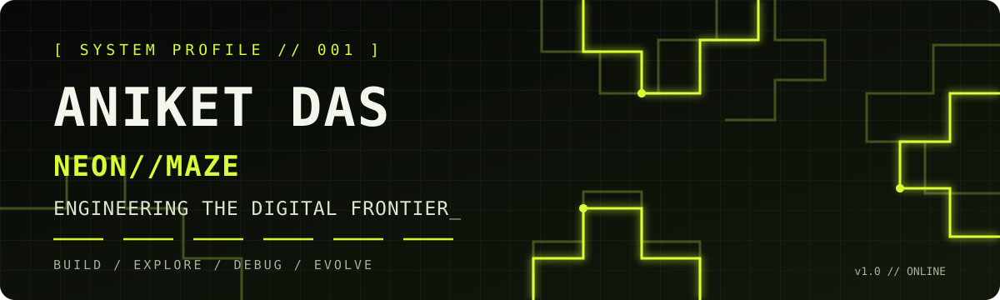
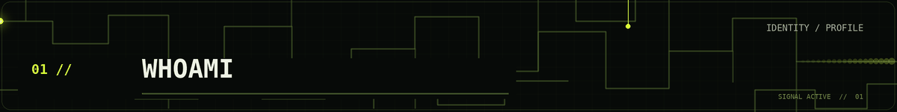
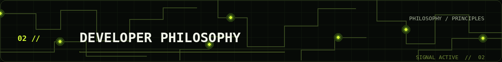
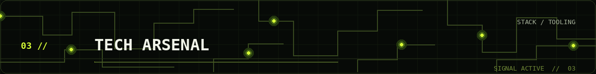
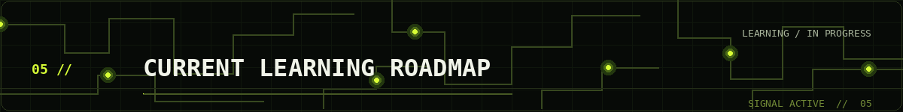
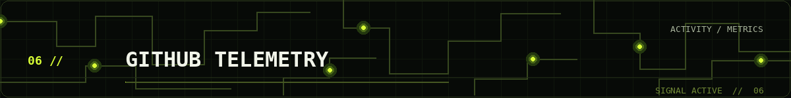
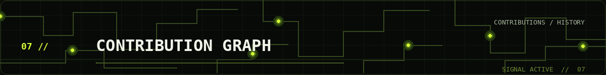
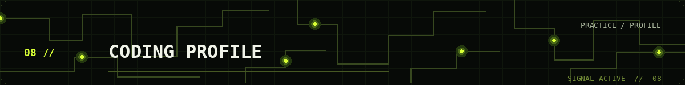
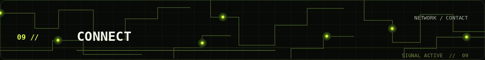

<div align="center">



<br/>

**Full-Stack Developer | MERN Stack | Machine Learning Enthusiast**

<br/>

<a href="https://github.com/aniket00101"></a>
<a href="https://linkedin.com/in/aniket-das-7766b129a"></a>
<a href="https://portfolio-psi-three-d6mmygainv.vercel.app/"></a>

<br/><br/>


</div>

<br/><br/>

<div align="center">
  
</div>

<br/>

Hi, I'm **Aniket Das** — a developer interested in building useful digital products, exploring modern web technologies, and understanding how intelligent systems can improve software experiences.

I work across frontend and backend development, with a focus on the **MERN ecosystem**, while also exploring machine learning and related technologies.

I enjoy turning ideas into working applications: designing interfaces, connecting APIs, handling data, and improving the experience from end to end.

```yaml
name: Aniket Das
github: aniket00101
role: Full-Stack Developer
focus:
  - MERN Stack Development
  - Backend & API Development
  - Machine Learning Exploration
  - Problem Solving
mindset: Build. Explore. Debug. Evolve.
```

<br/><br/>

<div align="center">
  
</div>

<br/>

> **"Don't just make it work. Understand why it works, make it better, and make it matter."**

- **Think before building.** Understand the problem before choosing the tools.
- **Build for people.** Good engineering solves a real need, not just a technical challenge.
- **Learn by shipping.** Turn concepts into projects, test assumptions, and improve through iteration.
- **Stay curious.** Technology changes; the habit of learning should not.

<br/><br/>

<div align="center">
  
</div>

<br/>

<div align="center">

`// LANGUAGES`


<br/><br/>

`// FRONTEND`


<br/><br/>

`// BACKEND & FRAMEWORKS`


<br/><br/>

`// DATABASES & REAL-TIME`


<br/><br/>

`// DATA, API & TOOLS`


</div>

<sub>Technology icons represent tools and technologies listed in the existing profile. Proficiency levels are intentionally not claimed.</sub>

<br/><br/>

<div align="center">
  
</div>

<br/>


<!-- FEATURED PROJECTS -->

<div align="center">


</div>

<p>An AI-powered smart agriculture platform designed to support informed farming decisions through machine learning, intelligent recommendations, and real-time environmental insights.</p>

**Key Features**
- AI-powered farming assistant
- Soil and weather-based crop recommendations
- Fertilizer recommendations with NPK analysis
- Crop market price prediction
- Crop yield forecasting
- Real-time weather updates

**Tech Stack**

`Python` `FastAPI` `React` `Tailwind CSS` `Scikit-learn` `XGBoost` `MongoDB`

<div align="center">
  <a href="https://github.com/aniket00101/GreenHand_V-2.0.0_Frontend">
    
  </a>
  &nbsp;
  <a href="https://green-hand-ai.vercel.app/">
    
  </a>
</div>

---

<div align="center">


</div>

<p>An IoT-based gas safety solution combining Random Forest-based detection and real-time sensor monitoring to identify potential gas leakage hazards and support automated safety responses.</p>

**Key Features**
- Real-time gas sensor monitoring
- ML-based hazard detection
- Automated electricity cutoff and ventilation activation
- System-generated call alerts
- Live monitoring and error-logging dashboard
- Online device booking and payment integration
- 24/7 AI chatbot for LPG safety guidance

**Tech Stack**

`Random Forest` `IoT` `MERN Stack` `FastAPI` `Payment Integration`

<div align="center">
  <a href="https://github.com/LPG-HackONit">
    
  </a>
  &nbsp;
  <a href="https://lpg-dun.vercel.app/">
    
  </a>
</div>

---

<div align="center">


</div>

<p>A voice-enabled assistance system designed to make device interaction more accessible through speech recognition and intelligent command processing.</p>

**Key Features**
- Voice-based device interaction
- Speech recognition and command processing
- Device control through voice commands
- Information retrieval
- Emergency assistance

**Tech Stack**

`AI/ML` `Speech Recognition` `IoT` `MERN Stack` `FastAPI`


<br/><br/>

<div align="center">
  
</div>

<br/>

The learning roadmap is intentionally editable. Update the items as priorities change.

| Focus area | Current direction |
|---|---|
| Full-stack engineering | Strengthening frontend-to-backend application development |
| Backend development | Improving API design, server-side logic and data handling |
| Machine learning | Exploring ML concepts and practical applications |
| Problem solving | Building consistency with coding challenges |

<br/><br/>

<div align="center">
  
</div>

<br/>

<div align="center">


<br/><br/>


<br/><br/>


</div>

<br/><br/>

<div align="center">
  
</div>

<br/>

<div align="center">


</div>

<br/><br/>

<div align="center">
  
</div>

<br/>

<div align="center">

<a href="https://leetcode.com/u/aniket800/">
  
</a>

<br/>

<a href="https://leetcode.com/u/aniket800/">
  
</a>

</div>

<br/><br/>

<div align="center">
  
</div>

<br/>

<div align="center">

**Have an idea, a technical question, or an interesting collaboration? Let's connect.**

<br/>

<a href="https://github.com/aniket00101"></a>
<a href="https://linkedin.com/in/aniket-das-7766b129a"></a>
<a href="https://portfolio-psi-three-d6mmygainv.vercel.app/"></a>

<br/><br/>


</div>
